# BRAVIA Glass TV

An Apple TV–style home screen for a Sony BRAVIA (Google TV), plus six small companion apps: Weather, Quran,
Quotes, TV Status, Doa Harian and Al-Ma'thurat.

Adapted by **[fajaril](https://github.com/fajaril)**, built on Glass TV by cocombee and CleanYourTV by Gathin.

> **Credit to the original developers.** This is a personal adaptation, not an original project. The
> home-screen launcher, the setup and install scripts, the debloat lists and the safeguards that put a TV
> back as it was all come from **[Glass TV](https://github.com/cocombee/glass-tv)** by **cocombee**, which
> is built on **[CleanYourTV](https://github.com/Gathin23/cleanyourtv)** by **Gathin**, with contributions
> from about 70 other people (their commits are kept in this repo's history). Both are MIT-licensed; see
> [LICENSE](LICENSE). We only adjusted it to our own preferences and added a few things for our home. If
> you find it useful, please star and follow the original projects.

The original project's README is kept as [GLASS-TV.md](GLASS-TV.md) and covers installing, debloating and
themes in general. What this repo adds is below.

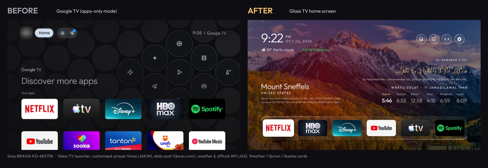

Tested on a Sony BRAVIA VU3 (KD-65X75K), Google TV / Android TV 14, over Ethernet.

## The home screen

| | |
|---|---|
| 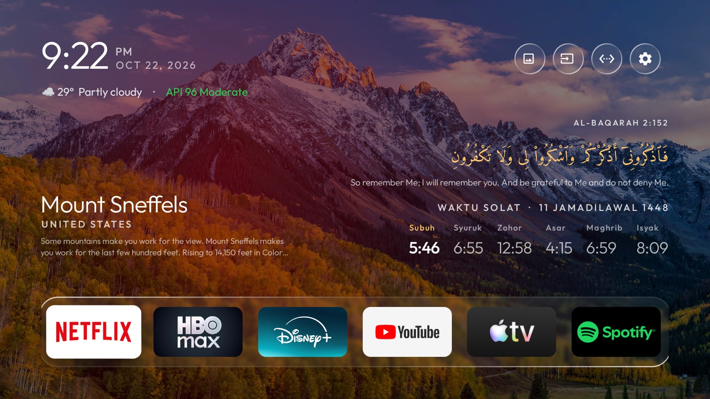 | 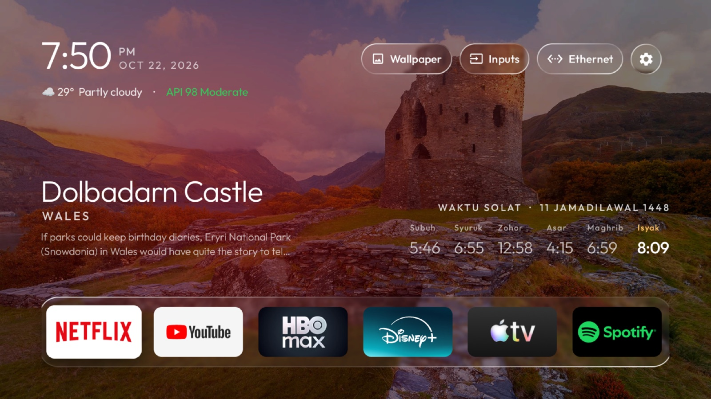 |
| 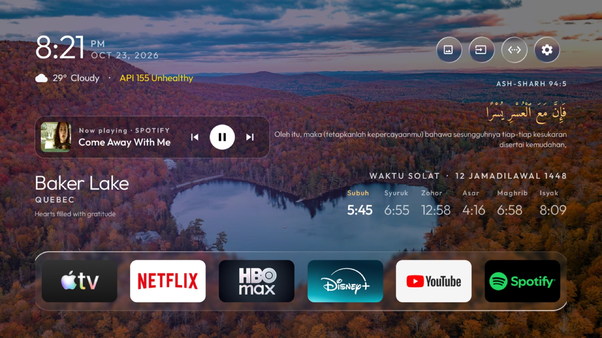 | 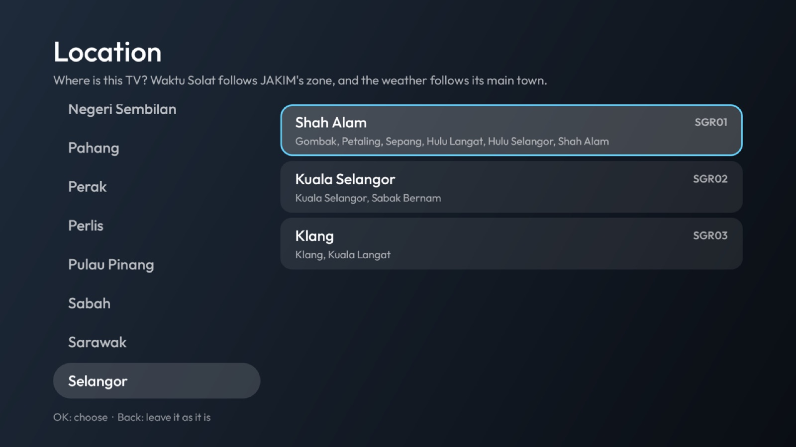 |
| 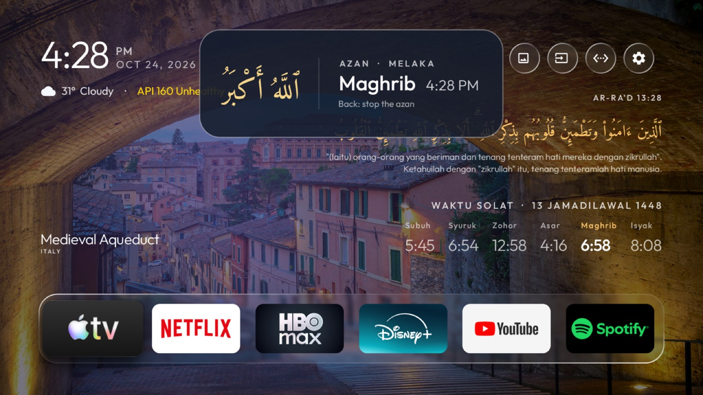 | 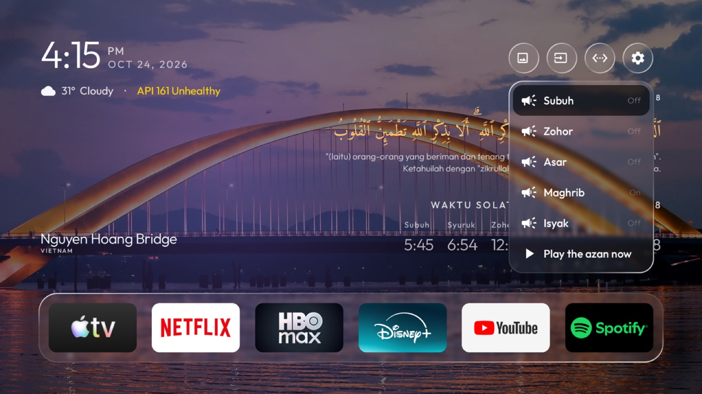 |
| 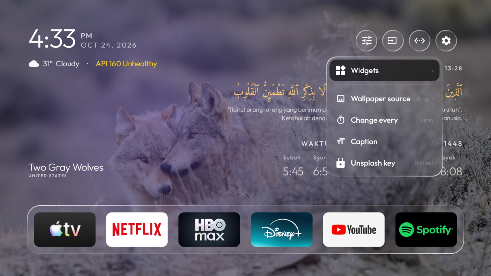 | 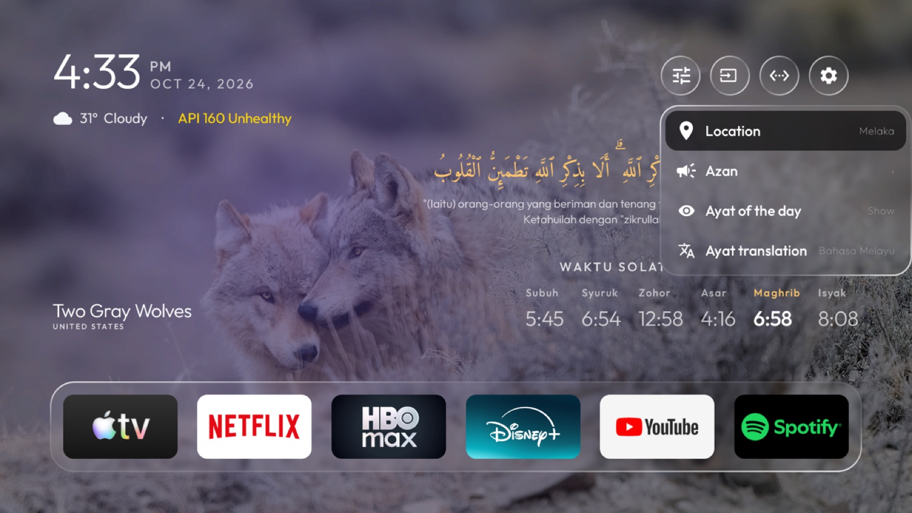 |
| 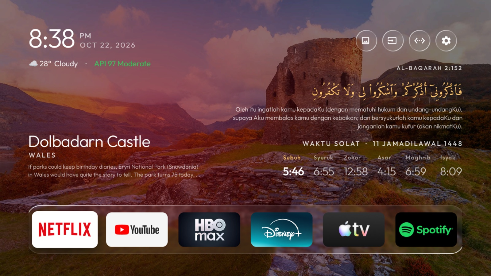 | 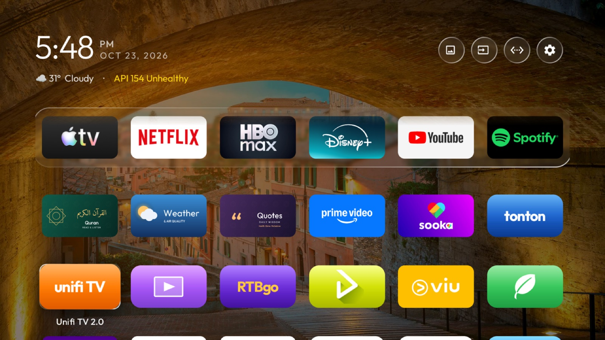 |

- **Location, set on the TV**: Home → Widgets → **Location**. Pick the state, then the
  JAKIM zone (all 60, each with its main town and districts). Waktu Solat, the weather line and the Weather
  app follow it at once. A new TV with no zone in its theme opens this screen by itself on the first start.
- **Azan at prayer time**: choose the prayers in Home → Widgets → **Azan** (Maghrib
  is on at first). While the TV is on, a floating glass card at the top comes over the app in front: video pauses,
  music pauses and resumes after; Back stops it. It never plays in standby or over Live TV / HDMI.
  The recording is the call to prayer at Masjid KLCC ([Internet Archive](https://archive.org/details/AzanZhurMasjidKlcc), CC0).
- **Waktu Solat**: today's prayer times from JAKIM e-Solat for the chosen zone, with the next prayer
  highlighted and the Hijri date.
- **Daily ayat**: one of 52 short verses a day above the prayer times, in Uthmani script with Malay
  (Basmeih) or English (Saheeh International) from Quran.com. It can be hidden from Home → Widgets → Ayat of the day.
- **Weather and air quality** under the clock: Open-Meteo weather and the official Malaysian API
  (Indeks Pencemar Udara) from the Department of Environment's APIMS feed. Select it to open the Weather app.
- **Wallpapers**: Bing (a rolling 60-day pool from the US, UK, Canada, Australia and India editions),
  Wikimedia Picture of the Day, Nature & Wildlife, NASA Image of the Day, Smithsonian Open Access art, and
  Unsplash (your own key, typed on the TV). It also lets you set how often the wallpaper changes, the text size and the place info.
- **Now Playing**: while Spotify or another music app plays (and for 3 minutes after a pause), a small card above the place
  name shows the song and cover with previous / play-pause / next; Up from the dock reaches it. The ayat
  of the day steps aside while it shows.
- **Round top buttons** that expand with their name when selected.
- **One Home menu** (the first top button): **Widgets** › (Location, Azan, Ayat of the day, Ayat translation),
  then the wallpaper: **Wallpaper source** › (Bing, Wikimedia, Nature & Wildlife, NASA, Smithsonian,
  Unsplash), **Change every**, **Caption** › (Text size, Place info) and **Unsplash key**.
- **App menu** (hold OK on an app): Move, Update, tvOS-style or the app's own tile, Hide from Home,
  App info, Hidden apps.
- **Clear selection**: the selected app grows by 14% and lifts on a shadow, as on tvOS.
- **tvOS-style tiles** for apps whose banners are plain: a gradient with the app's own icon, a wordmark
  or a vector symbol.
- **Lighter on memory**: a smaller glass blur, icons loaded at the screen's density, no colour-emoji font,
  and companion apps that close completely when you leave them.

Most of the code is in `launcher/app/src/main/java/com/gathin/tvhome/`: `PrayerTimes.java`,
`WeeklyAyah.java`, `HomeWeather.java`, `PlaceWallpapers.java`, `AppAdapter.java` (tile tables `TVOS`,
`WORDMARK`, `GLYPHS`) and `MainActivity.java`. The settings for this TV are in
[`themes/my-tv/config.json`](themes/my-tv/config.json).

## Companion apps

Each one is a plain Java Android TV app in [`apps/`](apps). Each gets a card on the Glass TV home screen.

| App | Package | What it does | Sources |
|---|---|---|---|
| [Weather](apps/weather-tv) | `com.glasstv.weather` | The chosen town's weather, 12-hour and 7-day forecast, API, and a dashboard of all 16 states | Open-Meteo, DOE APIMS |
| [Quran](apps/quran-tv) | `com.glasstv.quran` | 114 surahs, Malay / English translation, Alafasy recitation, offline once opened | Quran.com API v4 |
| [Quotes](apps/quotes-tv) | `com.glasstv.quotes` | A quote a day: hadith, the scholars, wisdom and peribahasa, with favourites. Works offline | Built-in `quotes.json` |
| [TV Status](apps/status-tv) | `com.glasstv.status` | Memory and storage rings, uptime, "Free up memory" and "Restart TV" (two presses); an Apps tab with the memory each app uses and Restart / Close / App info (through the TV's own debugging service, allowed once on the TV); and a Network tab that checks the router, internet line, DNS, download speed and streaming services, then says where a lag comes from | The TV itself, Cloudflare speed test |
| [Doa Harian](apps/doa-tv) | `com.glasstv.doa` | Daily duas in 12 groups, Arabic, English and recitation | Hisnul Muslim |
| [Al-Ma'thurat](apps/mathurat-tv) | `com.glasstv.mathurat` | Wazifah Sughra for the morning and the evening, recited line by line | Quran.com, Hisnul Muslim |

| | |
|---|---|
| 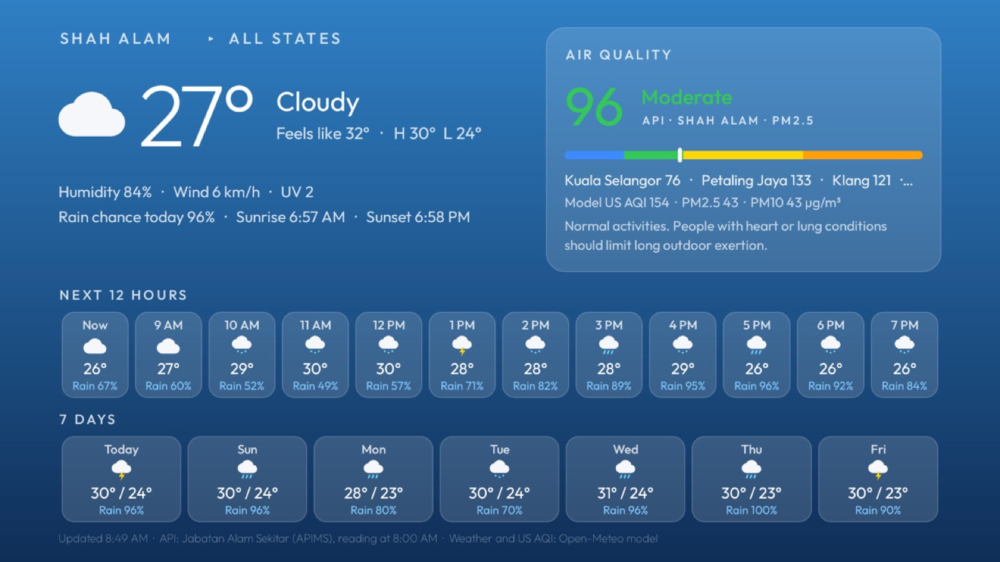 | 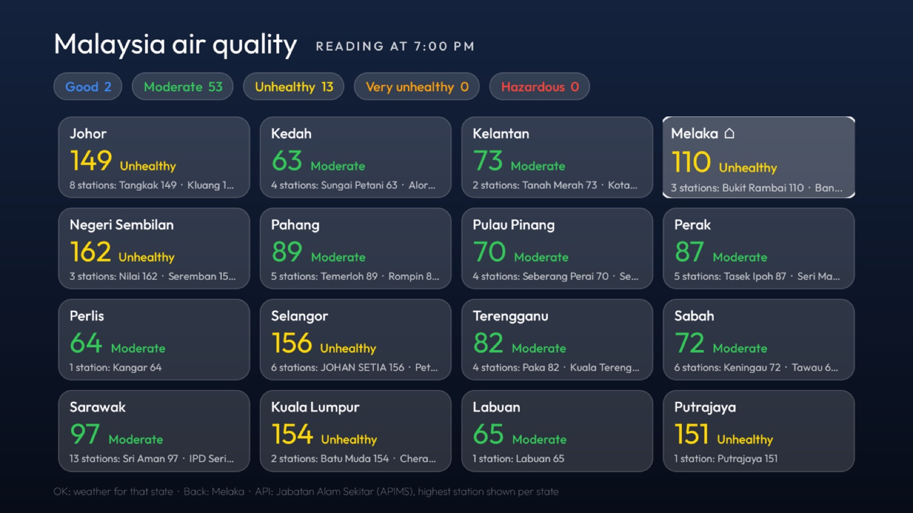 |
| 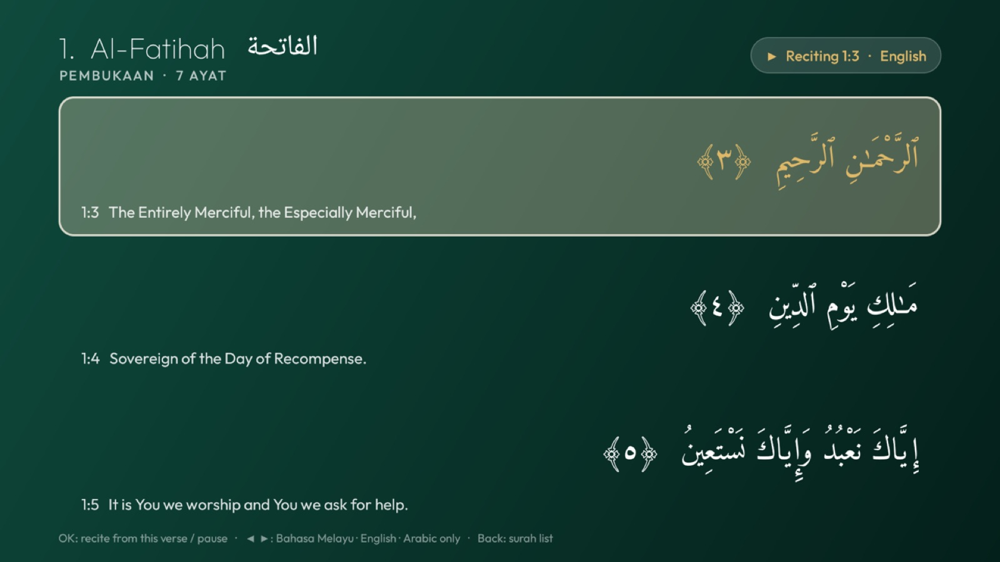 | 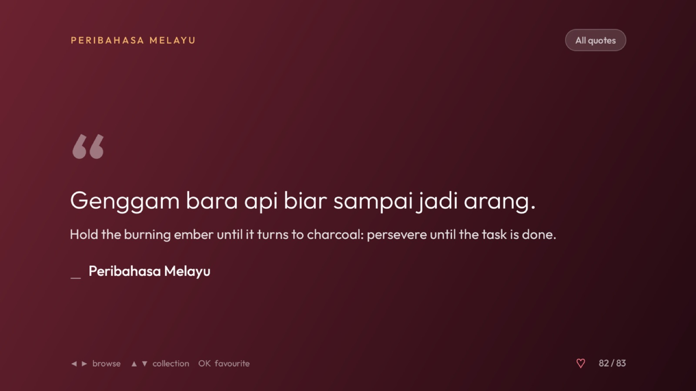 |
| 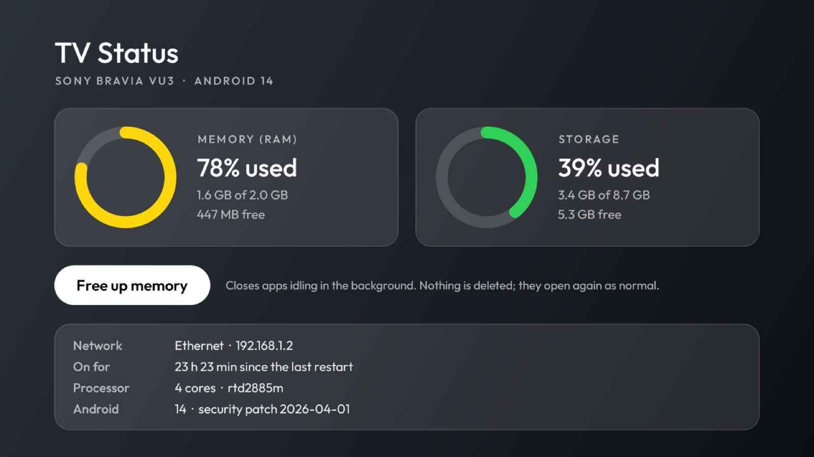 | 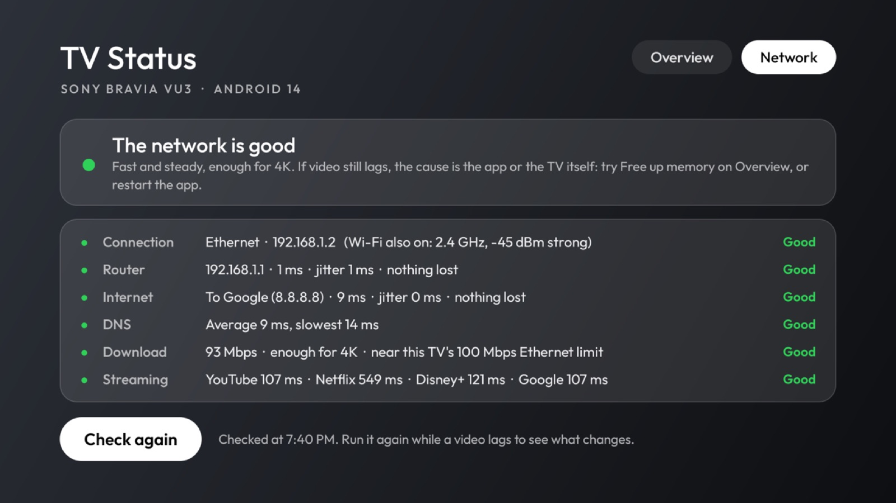 |
| 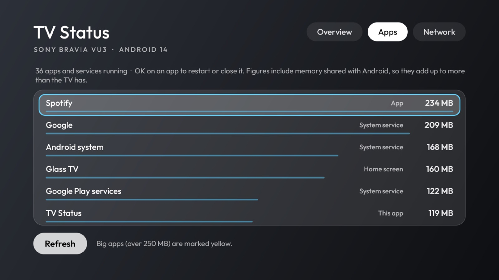 | 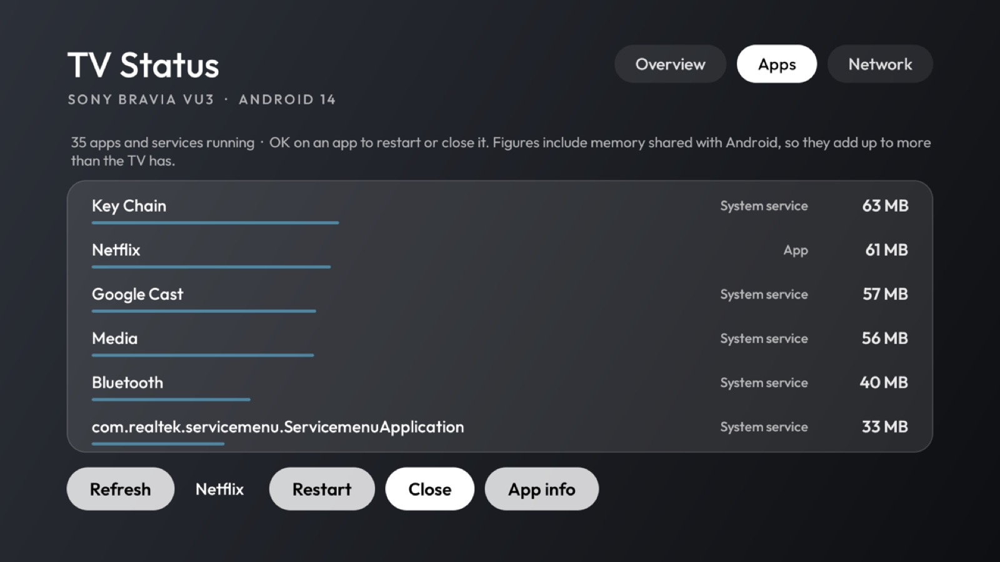 |
| 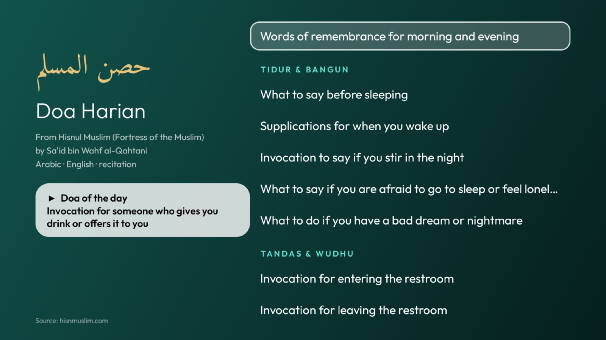 | 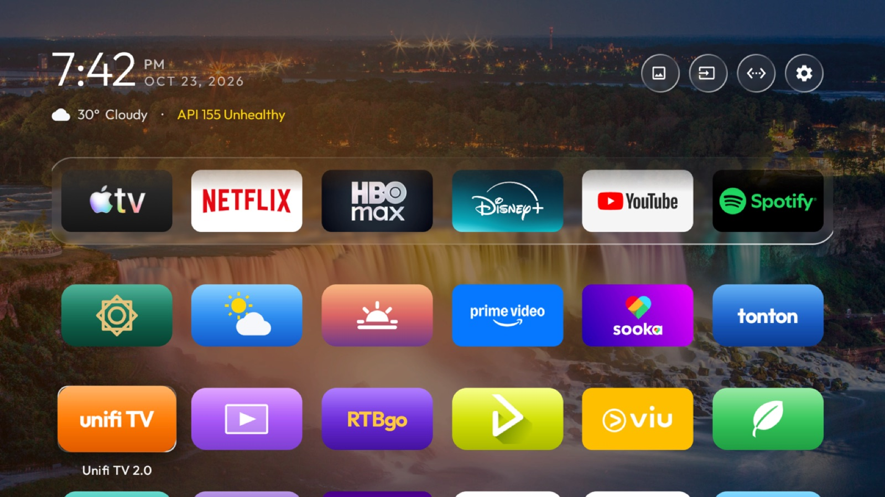 |
| 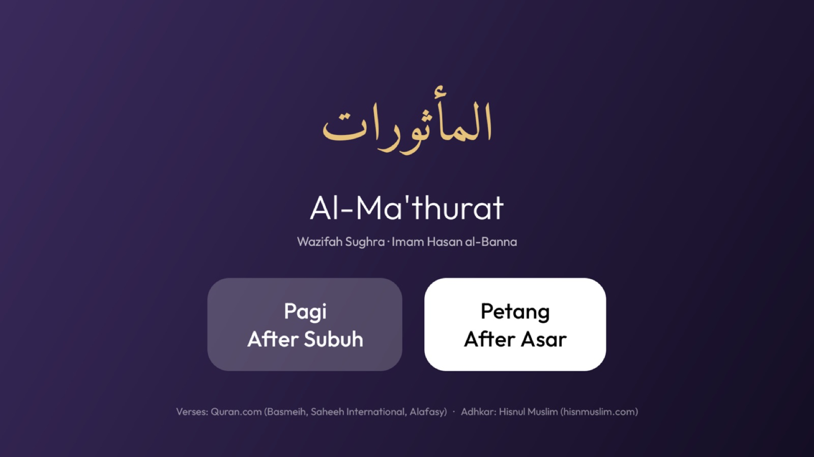 | 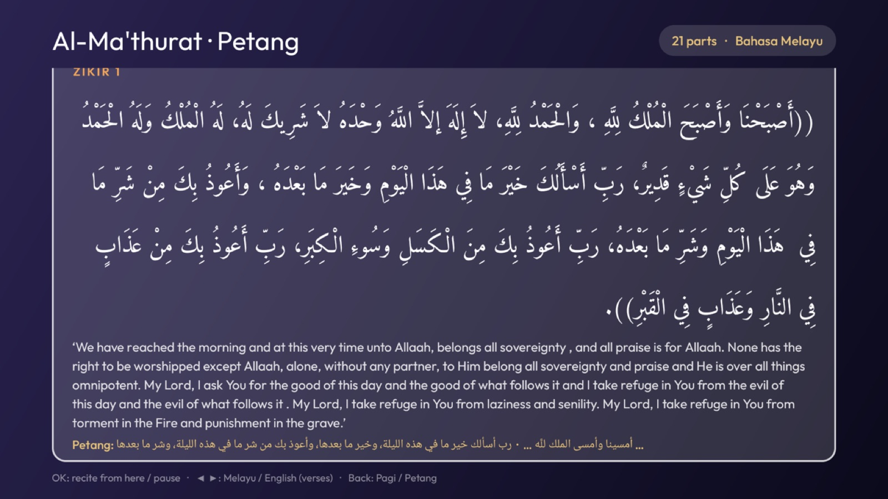 |

Notes on the religious text:
- Nothing is typed by hand. Verses, translations and recitation come from Quran.com, and duas and
  adhkar from Hisnul Muslim (hisnmuslim.com).
- Hisnul Muslim has no Malay, so Doa Harian and the adhkar in Al-Ma'thurat are Arabic and English only.
- Hisnul Muslim gives only the phrases that change in the evening. So Al-Ma'thurat's Petang shows the morning
  text with those phrases underneath, and turns off that zikir's (morning) recitation.
- The closing doa rabitah is not included, because neither source has it.

## Try it on your own TV

This was built and tested on one TV, a Sony BRAVIA KD-65X75K (Google TV, Android 14). It should work on
other **Android TV or Google TV sets and boxes with Android 8 or newer** (Sony, TCL, Xiaomi, Philips, many
Hisense, Chromecast with Google TV and so on). It **cannot** run on Samsung (Tizen), LG (webOS), Hisense VIDAA,
Roku or Apple TV. Check the TV's **Settings → About** first.

Everything here can be undone, and no system app is deleted: the setup only switches apps off, and puts the
TV's own home screen back if anything goes wrong.

### What you need

- A Mac or Linux computer on the same network as the TV (Windows works with the `.ps1` scripts).
- **JDK 17** and the **Android SDK** (platform 34, build-tools 34.0.0), in a folder whose path has no spaces.
- Python 3, for the small debugging client in `tools/`:
  `python3 -m venv tools/venv && tools/venv/bin/pip install -r tools/requirements.txt`
- On the TV: **Developer options → USB debugging** on (press OK seven times on Build in Settings → About
  first). The first connection shows "Allow USB debugging?" on the TV: tick **Always allow**.

The full step-by-step guide (connecting, backing up, switching off the TV's extras, installing) is in
[GLASS-TV.md](GLASS-TV.md). [AGENTS.md](AGENTS.md) is the same guide written for an AI coding assistant
(Claude Code and others): open this folder in one and ask it to set up Glass TV on your TV.

### Make it yours

1. **Location** — nothing to edit: after installing, set it on the TV (Home → Widgets →
   Location). On a new TV the Location screen opens by itself on the first start. Waktu Solat, the weather
   line and the Weather app follow it. (The air-quality reading is from Malaysia's Department of Environment
   and only shows within about 80 km of one of its stations.)
2. **Theme** — copy `themes/my-tv/` to a new folder and edit its `config.json`:
   - `dock_apps`: the apps in the dock, then the grid rows, in order (package names; list yours with
     `tools/tv.py 'pm list packages -3'`). Leave it short if you would rather arrange the apps on the TV.
   - `hidden_apps`: apps to leave off Home.
   - `prayer_zone`, `weather_lat`, `weather_lon`: only a default for before a location is chosen on the TV.
     Remove `prayer_zone` (or set it to `""`) so a new TV asks for its location. Outside Malaysia, leave it
     empty and skip the Location screen: there are no prayer times, and the weather line uses
     `weather_lat`/`weather_lon`.
   - `unsplash_key`: leave it empty; an Unsplash key, if you have one, is typed on the TV
     (Home → Unsplash key), never written here.
3. **Your TV's example list** — `examples/` has tested lists of what to switch off for many TVs. Use the one
   for your model, or let the guide help you make one.

### Build and install

```bash
export JAVA_HOME=/path/to/jdk-17 ANDROID_HOME=/path/to/android-sdk TV_HOST=192.168.1.x   # your TV's address

# The home screen. It checks itself on the TV and puts the TV's own home screen back if anything fails.
INPUT_KEY_SERVICE=1 launcher/build-and-install.sh

# Your theme
tools/theme.sh themes/your-tv

# Each companion app you want (weather-tv, quran-tv, quotes-tv, status-tv, doa-tv, mathurat-tv)
(cd apps/quran-tv && ./gradlew assembleRelease)
tools/venv/bin/python -I tools/b64push.py apps/quran-tv/app/build/outputs/apk/release/app-release.apk /data/local/tmp/app.apk
tools/venv/bin/python -I tools/tv.py 'pm install -r /data/local/tmp/app.apk; rm /data/local/tmp/app.apk'
```

(`adb install` works too, if you have Android's platform tools.) Install Glass TV **before** the Weather
app: the Weather app reads the location from Glass TV, and only apps built on the same computer may read it. The first time an app with a card is
installed, Glass TV asks on the TV whether to show it; hold OK on Settings to manage the cards later.

### One-time permissions on the TV

- **Now Playing** (the music card on Home) needs Glass TV allowed to see what is playing. Run once:
  `tools/tv.py 'cmd notification allow_listener com.gathin.tvhome/com.gathin.tvhome.MediaAccess'`.
  It reads no notifications.
- **TV Status → Apps**, **Restart TV** and Glass TV's **cache cleaning** use the TV's own debugging
  service. The first time each one runs, the TV asks "Allow USB debugging?": tick **Always allow** and choose
  **Allow**. They need USB debugging left on; with it off, they simply do nothing.

### Undo

`tools/restore.sh` brings the TV's own home screen back and switches everything on again; `tools/theme.sh
--reset` removes the theme. Companion apps uninstall like any app. See "Undo" in [GLASS-TV.md](GLASS-TV.md).

## Showcase

All the screenshots are in [`showcase/`](showcase), including three Apple-style posters
(`poster-*.jpg`).

## Credits and licences

- **[Glass TV](https://github.com/cocombee/glass-tv)** by cocombee, built on
  **[CleanYourTV](https://github.com/Gathin23/cleanyourtv)** © 2026 Gathin, MIT ([LICENSE](LICENSE)), with
  contributions from about 70 others. The launcher, scripts, debloat lists and guides are theirs; this repo
  only adjusts them and adds the companion apps, all under the same MIT licence.
- Adaptation and companion apps: **[fajaril](https://github.com/fajaril)**.
- Fonts: Outfit and Amiri Quran, SIL Open Font License (licence files next to the fonts).
- Azan recording: Masjid KLCC call to prayer, recorded by Bryce Fegley,
  [Internet Archive](https://archive.org/details/AzanZhurMasjidKlcc), CC0 public domain.
- Data: JAKIM e-Solat, Quran.com, Hisnul Muslim, Open-Meteo, Jabatan Alam Sekitar (APIMS), Bing,
  Wikimedia Commons, NASA, Smithsonian Open Access and Unsplash. Each is used under its own terms.
