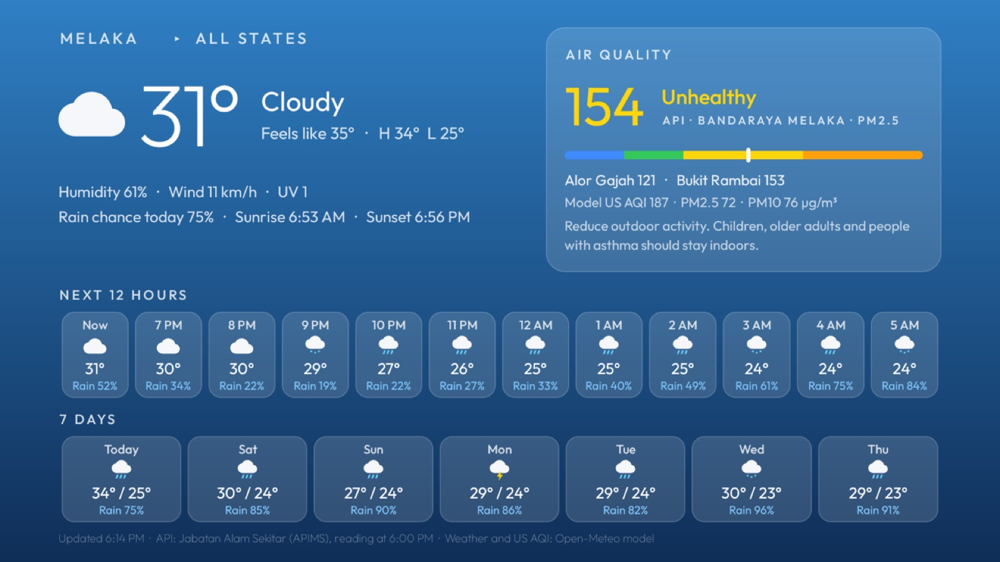

# BRAVIA Glass TV

An Apple TV–style home screen for a Sony BRAVIA (Google TV), set up for a home in Melaka, Malaysia, plus
six small companion apps: Weather, Quran, Quotes, TV Status, Doa Harian and Al-Ma'thurat.

It is built on [Glass TV](https://github.com/cocombee/glass-tv) by Gathin (MIT). The original project's
README is kept as [GLASS-TV.md](GLASS-TV.md) and covers installing, debloating and themes in general.
This repo adds the customisations below.


Tested on a Sony BRAVIA VU3 (KD-65X75K), Google TV / Android TV 14, over Ethernet.

## The home screen

| | |
|---|---|
|  |  |
|  |  |

- **Waktu Solat**: today's prayer times from JAKIM e-Solat (zone `MLK01`), with the next prayer
  highlighted and the Hijri date.
- **Daily ayat**: one of 52 short verses a day above the prayer times, in Uthmani script with Malay
  (Basmeih) or English (Saheeh International) from Quran.com.
- **Weather and air quality** under the clock: Open-Meteo weather and the official Malaysian API
  (Indeks Pencemar Udara) from the Department of Environment's APIMS feed. Select it to open the Weather app.
- **Wallpapers**: Bing (a rolling 60-day pool from the US, UK, Canada, Australia and India editions),
  Wikimedia Picture of the Day, Nature & Wildlife, NASA Image of the Day, Smithsonian Open Access art, and
  Unsplash (your own key, typed on the TV). It also lets you set how often the wallpaper changes, the text size and the place info.
- **Round top buttons** that expand with their name when selected.
- **App menu** (hold OK on an app): Move, Update, tvOS-style or the app's own tile, Hide from Home,
  App info, Hidden apps.
- **tvOS-style tiles** for apps whose banners are plain: a gradient with the app's own icon, a wordmark
  or a vector symbol.
- **Lighter on memory**: a smaller glass blur, icons loaded at the screen's density, no colour-emoji font,
  and companion apps that close completely when you leave them.

Most of the code is in `launcher/app/src/main/java/com/gathin/tvhome/`: `PrayerTimes.java`,
`WeeklyAyah.java`, `HomeWeather.java`, `PlaceWallpapers.java`, `AppAdapter.java` (tile tables `TVOS`,
`WORDMARK`, `GLYPHS`) and `MainActivity.java`. The settings for this TV are in
[`themes/my-tv/config.json`](themes/my-tv/config.json).

## Companion apps

Each one is a plain Java Android TV app in [`apps/`](apps). Each gets a card on the Glass TV home screen.

| App | Package | What it does | Sources |
|---|---|---|---|
| [Weather](apps/weather-tv) | `com.glasstv.weather` | Melaka weather, 12-hour and 7-day forecast, API, and a dashboard of all 16 states | Open-Meteo, DOE APIMS |
| [Quran](apps/quran-tv) | `com.glasstv.quran` | 114 surahs, Malay / English translation, Alafasy recitation, offline once opened | Quran.com API v4 |
| [Quotes](apps/quotes-tv) | `com.glasstv.quotes` | A quote a day: hadith, the scholars, wisdom and peribahasa, with favourites. Works offline | Built-in `quotes.json` |
| [TV Status](apps/status-tv) | `com.glasstv.status` | Memory and storage rings, network, uptime, and "Free up memory" | The TV itself |
| [Doa Harian](apps/doa-tv) | `com.glasstv.doa` | Daily duas in 12 groups, Arabic, English and recitation | Hisnul Muslim |
| [Al-Ma'thurat](apps/mathurat-tv) | `com.glasstv.mathurat` | Wazifah Sughra for the morning and the evening, recited line by line | Quran.com, Hisnul Muslim |

| | |
|---|---|
|  |  |
|  |  |
|  |  |
|  |  |

Notes on the religious text:
- Nothing is typed by hand. Verses, translations and recitation come from Quran.com, and duas and
  adhkar from Hisnul Muslim (hisnmuslim.com).
- Hisnul Muslim has no Malay, so Doa Harian and the adhkar in Al-Ma'thurat are Arabic and English only.
- Hisnul Muslim gives only the phrases that change in the evening. So Al-Ma'thurat's Petang shows the morning
  text with those phrases underneath, and turns off that zikir's (morning) recitation.
- The closing doa rabitah is not included, because neither source has it.

## Building

You need JDK 17 and the Android SDK (platform 34). Every app is signed with your debug key, because they are
sideloaded, not published.

```bash
export JAVA_HOME=/path/to/jdk-17 ANDROID_HOME=/path/to/android-sdk TV_HOST=192.168.1.x

# The launcher (INPUT_KEY_SERVICE=1 turns the Input button service back on after a reinstall)
INPUT_KEY_SERVICE=1 launcher/build-and-install.sh

# The theme for this TV
tools/theme.sh themes/my-tv

# A companion app
cd apps/weather-tv && ./gradlew assembleRelease
```

Install a companion APK with `python tools/tv.py` (a small adb client in Python, see
`tools/requirements.txt`) or with `adb install`. The first time a card is added, Glass TV asks on the TV
whether to show it. You can also hold OK on Settings to manage the cards.

To undo everything, see "Undo" in [GLASS-TV.md](GLASS-TV.md). In short, `tools/restore.sh` brings back the
Google TV home screen.

## Showcase

All the screenshots are in [`showcase/`](showcase), including three Apple-style posters
(`poster-*.jpg`).

## Credits and licences

- [Glass TV](https://github.com/cocombee/glass-tv) © Gathin, MIT ([LICENSE](LICENSE)). The changes and the
  companion apps here are under the same licence.
  Glass TV itself is based on [Clean Your TV](https://github.com/Gathin23/cleanyourtv) by Gathin (MIT).
- Fonts: Outfit and Amiri Quran, SIL Open Font License (licence files next to the fonts).
- Data: JAKIM e-Solat, Quran.com, Hisnul Muslim, Open-Meteo, Jabatan Alam Sekitar (APIMS), Bing,
  Wikimedia Commons, NASA, Smithsonian Open Access and Unsplash. Each is used under its own terms.
